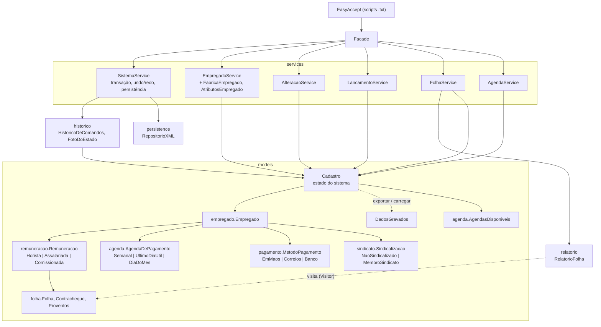

# WePayU - Sistema de Folha de Pagamento

[](https://www.oracle.com/java/)
[](http://easyaccept.sourceforge.net/)
[](https://conventionalcommits.org)
[](https://ic.ufal.br/)

Projeto acadêmico desenvolvido para a disciplina de **Programação 2 (P2) / Programação Orientada a Objetos**, no curso de **Bacharelado em Ciência da Computação** do **Instituto de Computação (IC)** da **Universidade Federal de Alagoas (UFAL)**.

---

## Sumário

- [1. Visão Geral do Sistema](#1-visão-geral-do-sistema)
- [2. Arquitetura e Padrões de Projeto (GoF)](#2-arquitetura-e-padrões-de-projeto-gof)
- [3. Princípios SOLID Aplicados](#3-princípios-solid-aplicados)
- [4. Regras Obrigatórias e Diretrizes de Qualidade](#4-regras-obrigatórias-e-diretrizes-de-qualidade)
- [5. Regras de Pagamento](#5-regras-de-pagamento)
- [6. Milestones e User Stories](#6-milestones-e-user-stories)
- [7. Persistência de Dados](#7-persistência-de-dados)
- [8. Padrão de Versionamento (Conventional Commits)](#8-padrão-de-versionamento-conventional-commits)
- [9. Como Executar os Testes](#9-como-executar-os-testes)
- [10. Autoria](#10-autoria)

---

## 1. Visão Geral do Sistema

O **WePayU** é uma implementação do clássico problema de automação de folha de pagamento empresarial, inspirado no estudo de caso de Robert C. Martin (*Agile Software Development: Principles, Patterns, and Practices*).

### Objetivos Principais:
- **Separação Rígida de Camadas**: O sistema concentra-se **exclusivamente na lógica de negócio**, sem interface gráfica com o usuário (GUI). Toda a comunicação externa é realizada através de uma fachada pública orientada a scripts de teste.
- **Conformidade de Requisitos**: Obter **100% de aprovação** nos testes de aceitação automatizados executados pelo framework **EasyAccept**.
- **Modelagem Orientada a Objetos**: Utilização intensiva de polimorfismo, herança semântica, baixo acoplamento e alta coesão.

---

## 2. Arquitetura e Padrões de Projeto (GoF)



> Os pacotes `exceptions` e `utils` são usados por todas as camadas e ficaram fora do diagrama para não poluí-lo.
>
> Documentação detalhada dos pacotes:
> - **Domínio**: [`WePayU/src/br/ufal/ic/p2/wepayu/models/README.md`](WePayU/src/br/ufal/ic/p2/wepayu/models/README.md)
> - **Serviços e transações**: [`WePayU/src/br/ufal/ic/p2/wepayu/services/README.md`](WePayU/src/br/ufal/ic/p2/wepayu/services/README.md)

### Pacotes

| Pacote | Conteúdo |
|---|---|
| `wepayu` | `Facade` (ponto de entrada do EasyAccept) e `Main` |
| `exceptions` | `WePayUException` (classe-mãe) e os erros agrupados em `empregado`, `validacao`, `sindicato`, `pagamento`, `agenda` e `sistema` |
| `models` | `Cadastro` (o estado do sistema), `DadosGravados` (a cópia que vai para o arquivo), `Periodo`, `Centavos`, `LancamentoDeValor` e o domínio dividido por assunto: `empregado`, `remuneracao`, `agenda`, `sindicato`, `pagamento`, `folha` |
| `services` | casos de uso, chamados pela fachada |
| `historico` | undo/redo |
| `persistence` | gravação em XML |
| `relatorio` | texto do relatório da folha |
| `utils` | leitura dos parâmetros (`LeitorDeEntrada`), formatação da saída (`Formatador`) e regras de preenchimento (`Validacao`) |

### Padrões de Projeto Empregados

1. **Façade**: [`Facade`](WePayU/src/br/ufal/ic/p2/wepayu/Facade.java) só encaminha. Cada método tem uma linha: os comandos que alteram o estado passam por `SistemaService.executar`, e as consultas vão direto ao serviço.
2. **Strategy**: o que varia num empregado é um objeto trocável.
   - [`Remuneracao`](WePayU/src/br/ufal/ic/p2/wepayu/models/remuneracao/Remuneracao.java): cada tipo sabe quanto o empregado ganha num período.
   - [`AgendaDePagamento`](WePayU/src/br/ufal/ic/p2/wepayu/models/agenda/AgendaDePagamento.java): quando o empregado recebe, que dias cada pagamento cobre e que parte do salário mensal cabe a um pagamento (US9). As agendas novas da US10 são interpretadas por [`DescricaoDeAgenda`](WePayU/src/br/ufal/ic/p2/wepayu/models/agenda/DescricaoDeAgenda.java).
   - [`MetodoPagamento`](WePayU/src/br/ufal/ic/p2/wepayu/models/pagamento/MetodoPagamento.java): em mãos, correios ou banco.
   - [`Sindicalizacao`](WePayU/src/br/ufal/ic/p2/wepayu/models/sindicato/Sindicalizacao.java): filiado ou não filiado (*Null Object*, em vez de `null`).

   Trocar o tipo do empregado troca só a remuneração. O empregado continua o mesmo objeto, com cartões, vendas e dívida sindical.
3. **Template Method**: `Remuneracao.gerarContracheque` fixa o roteiro do contracheque (período, proventos e desconto do sindicato), e cada tipo preenche as etapas que variam.
4. **Visitor**: [`RelatorioFolha`](WePayU/src/br/ufal/ic/p2/wepayu/relatorio/RelatorioFolha.java) recebe cada contracheque pelo método do seu tipo e o escreve na seção certa, sem perguntar o tipo do empregado.
5. **Factory**: [`FabricaEmpregado`](WePayU/src/br/ufal/ic/p2/wepayu/services/FabricaEmpregado.java) valida os parâmetros de contratação. O enum [`TipoEmpregado`](WePayU/src/br/ufal/ic/p2/wepayu/models/remuneracao/TipoEmpregado.java) cria a remuneração de cada tipo, sem `switch`.
6. **Command + Memento**: [`SistemaService`](WePayU/src/br/ufal/ic/p2/wepayu/services/SistemaService.java) executa cada comando como uma transação. Ele fotografa o estado antes ([`FotoDoEstado`](WePayU/src/br/ufal/ic/p2/wepayu/historico/FotoDoEstado.java)) e restaura essa foto se o comando falhar. Se der certo, guarda o par antes/depois no [`HistoricoDeComandos`](WePayU/src/br/ufal/ic/p2/wepayu/historico/HistoricoDeComandos.java), para o undo e o redo.

---

## 3. Princípios SOLID Aplicados

- **S (SRP)**: cada serviço cuida de um assunto: cadastro, alteração, lançamentos, folha ou ciclo de vida. O relatório é montado em `relatorio`, a leitura de texto em `utils.LeitorDeEntrada` e a gravação em `persistence`.
- **O (OCP)**: um novo tipo de empregado é uma nova `Remuneracao` com uma constante em `TipoEmpregado`. Uma nova forma de pagamento é um novo `MetodoPagamento`. A folha não muda nos dois casos.
- **L (LSP)**: qualquer `Remuneracao`, `MetodoPagamento` ou `Sindicalizacao` pode ser usada onde a classe-mãe é esperada. A folha trata todos da mesma forma.
- **I (ISP)**: `VisitanteDeContracheque` só tem o necessário para tratar cada tipo de contracheque.
- **D (DIP)**: a fachada e os serviços dependem das abstrações do domínio (`Remuneracao`, `Sindicalizacao`, `MetodoPagamento`), nunca de uma subclasse escolhida por `if`.

---

## 4. Regras Obrigatórias e Diretrizes de Qualidade

> [!CAUTION]
> As seguintes regras são **obrigatórias e rigorosamente avaliadas** pelos monitores e professor da disciplina:

| Regra | Como o projeto cumpre |
|---|---|
| **Proibido o uso de `instanceof`** | O código não tem `instanceof` nem checagem de tipo por `getClass()`. O que só existe para um tipo é pedido por polimorfismo (`comoHorista()`, `comoComissionado()`, `comoMembro()`, `comoBanco()`). Nos outros tipos, esses métodos lançam o erro de negócio certo. |
| **Proibido lançar Exceções Genéricas** | Todo erro é uma subclasse de `WePayUException`, com a mensagem exata que o EasyAccept espera. Falhas de arquivo viram `ArquivoException`, que guarda a causa original. |
| **Princípio DRY** | As regras de preenchimento ficam em `Validacao`. A leitura de parâmetros fica em `LeitorDeEntrada`. A soma por período fica em `LancamentoDeValor`. Os erros de salário, comissão e taxa sindical são três classes parametrizadas por `CampoNumerico`. |
| **Herança Semântica Correta** | Cada subclasse é um caso concreto da classe-mãe: `ResultadoVenda` e `TaxaServico` são lançamentos de valor, e `RemuneracaoComissionada` estende `RemuneracaoAssalariada`, porque, pelo enunciado, o comissionado é um assalariado que também recebe comissão. |
| **Foco em Polimorfismo** | A folha, os atributos e as alterações não usam `switch` nem `if` em cadeia sobre o tipo. As alterações e as consultas de atributo usam tabelas de funções. |

Outras garantias:
- **Encapsulamento**: o domínio não tem setters de listas. Cartões, vendas e taxas saem como listas somente para leitura, e os construtores copiam as listas que recebem. Remunerações, formas de pagamento, filiação e lançamentos são imutáveis.
- **Objetos sempre válidos**: os construtores rejeitam nome ou endereço vazio, salário negativo, horas não positivas, data ausente e banco sem agência ou conta.
- **Dinheiro em `BigDecimal`**: sem erro de arredondamento de `double`. Os cortes em centavos da comissão usam `RoundingMode.DOWN` explicitamente.

---

## 5. Regras de Pagamento

Cada empregado tem uma **agenda de pagamento**, que diz quando ele recebe e que dias cada pagamento cobre. O **tipo** diz quanto ele ganha nesse período. Na contratação, o empregado recebe a agenda padrão do seu tipo e pode trocá-la por qualquer agenda disponível (US9). Trocar de tipo volta à agenda padrão do novo tipo.

A direção pode oferecer novas agendas com `criarAgendaDePagamentos` (US10):
- `semanal D`: toda semana no dia D, de 1 (segunda) a 7 (domingo);
- `semanal N D`: a cada N semanas (1 a 52) no dia D;
- `mensal D`: todo dia D do mês (1 a 28), útil ou não;
- `mensal $`: no último dia útil do mês.

Descrições equivalentes, como `semanal 1 5` e `semanal 5`, são a mesma agenda. As agendas criadas são gravadas no arquivo de dados e somem com `zerarSistema`.

| Agenda | Quando recebe | Período coberto | Padrão de |
|---|---|---|---|
| `semanal 5` | toda sexta-feira | 7 dias | horista |
| `mensal $` | último dia **útil** do mês (sem considerar feriados) | do dia seguinte ao pagamento anterior até o dia | assalariado |
| `semanal 2 5` | a cada 2 sextas, a partir de 14/01/2005 | 14 dias | comissionado |
| `semanal N D` | a cada N semanas no dia D; o primeiro pagamento é o N-ésimo dia D a partir de 01/01/2005 | 7 × N dias | (criada) |
| `mensal D` | todo dia D do mês | do dia seguinte ao pagamento anterior até o dia | (criada) |

| Tipo | Bruto do período |
|---|---|
| Horista | horas normais × salário/hora + horas extras × 1,5 × salário/hora; as extras são o que passa de 8 horas em cada dia, somando os cartões da mesma data |
| Assalariado | o salário mensal inteiro na agenda mensal, ou `salario × 12 × semanas / 52` na semanal (truncado em centavos) |
| Comissionado | a mesma parte fixa do assalariado + comissão sobre as vendas do período (truncada em centavos) |

O período nunca inclui dias que um pagamento anterior já cobriu. Assim, horas, vendas e taxa sindical não são pagas nem cobradas duas vezes quando o empregado muda de agenda ou de tipo. Nesse caso, a parte fixa do salário fica proporcional aos dias ainda não pagos. Exemplo: um assalariado de 1300,00 que recebeu a semana de 1/1 a 7/1 e passou para a agenda mensal recebe 1300 × 24/31 = 1006,45 em 31/1.

**Sindicato**: em cada pagamento, o desconto é a soma de três partes:
- a taxa sindical diária, multiplicada pelos dias desde o último pagamento do empregado (mesmo que ele tenha mudado de tipo nesse meio-tempo);
- as taxas de serviço ainda não cobradas;
- a dívida anterior.

O contracheque nunca fica negativo. O que o bruto não cobre vira dívida para o próximo pagamento. Cada taxa de serviço é cobrada uma única vez.

**Contratação**: pelas regras do `us7.txt`, assalariados e comissionados são contratados em 01/01/2005, e o horista no dia do primeiro cartão de ponto. A data é fixada na admissão e não muda com a troca de tipo: quem entrou assalariado e virou horista continua contratado em 01/01/2005. A contagem das semanas da agenda começa na contratação: um horista em `semanal 2 5` com o primeiro cartão em 10/1 recebe em 21/1. Ninguém recebe, em nenhuma agenda, antes de ser contratado, e a taxa sindical não é cobrada em pagamentos anteriores à contratação. O primeiro pagamento não é proporcional aos dias trabalhados, porque o `us7.txt` diz expressamente que esse caso é ignorado.

**Folha**: `rodaFolha` calcula os contracheques sem alterar nada, grava o relatório e só então efetiva os pagamentos. Se a gravação falhar, nada muda. Cada empregado guarda o dia do último pagamento, e esse registro também vai para o XML. Assim, ninguém recebe duas vezes pelo mesmo dia, nem em outra sessão. O relatório de cada folha efetivada também fica guardado: rodar de novo a folha de um dia já pago grava exatamente o mesmo relatório ("rodar a folha duas vezes deve dar o mesmo resultado", `us7.txt`).

**Números**: valores são aceitos só por extenso, com vírgula ou ponto decimal (`23`, `2300,45`, `-1`). Notação científica como `1e3` é recusada com a mensagem do campo.

**Mensagens de erro**: nos lançamentos e nas consultas, o empregado e o seu tipo são conferidos antes das datas e dos valores. Assim, lançar um cartão para um assalariado dá "Empregado nao eh horista.", mesmo que a data também esteja errada. Depois de `encerrarSistema`, qualquer comando ou consulta dá "Nao pode dar comandos depois de encerrarSistema.".

---

## 6. Milestones e User Stories

### Milestone 1 (User Stories 1 a 8)
- [x] **US1**: Adição de Empregados (Horista, Assalariado, Comissionado)
- [x] **US2**: Remoção de Empregados
- [x] **US3**: Lançamento de Cartão de Ponto (horas normais e horas extras a 1.5x)
- [x] **US4**: Lançamento de Resultado de Vendas (comissões)
- [x] **US5**: Lançamento de Taxa de Serviço Sindical
- [x] **US6**: Alteração de Detalhes do Empregado (dados cadastrais, filiação ao sindicato, método de pagamento)
- [x] **US7**: Rodar a Folha de Pagamento para o dia indicado
- [x] **US8**: Sistema de Transações Undo/Redo

### Milestone 2 (User Stories 9 e 10)
- [x] **US9**: Agendas de Pagamento padrão (`semanal 5`, `mensal $`, `semanal 2 5`)
- [x] **US10**: Criação de novas Agendas de Pagamento customizadas pela direção da empresa (`criarAgendaDePagamentos`)

---

## 7. Persistência de Dados

Conforme especificado, o projeto não usa banco de dados relacional:
- O estado inteiro é gravado em `wepayu.xml` com `java.beans.XMLEncoder` e recuperado com `java.beans.XMLDecoder`: os empregados com os seus lançamentos, o contador de identificações (um id nunca é reaproveitado), as agendas de pagamento oferecidas e os relatórios das folhas efetivadas. A cópia gravada é o [`DadosGravados`](WePayU/src/br/ufal/ic/p2/wepayu/models/DadosGravados.java).
- As classes do domínio não têm setters. O XML as reconstrói pelos construtores marcados com `@ConstructorProperties`. As receitas para `LocalDate`, `BigDecimal` e listas somente para leitura ficam em [`RepositorioXML`](WePayU/src/br/ufal/ic/p2/wepayu/persistence/RepositorioXML.java).
- A gravação escreve primeiro num arquivo temporário e só depois substitui o arquivo anterior. Um arquivo ilegível gera `ArquivoException` em vez de começar o sistema vazio sem avisar.
- Nada vai para o arquivo antes de `encerrarSistema`, que grava o estado para o próximo script. Isso vale também para `zerarSistema`: se ele for desfeito com `undo`, os dados gravados continuam intactos.

---

## 8. Padrão de Versionamento (Conventional Commits)

O projeto adota a convenção padronizada de mensagens de commit baseada no [Conventional Commits](https://www.conventionalcommits.org/pt-br/v1.0.0/):

```text
<tipo>(<escopo>): <descrição no imperativo e em minúsculas>

[corpo opcional detalhando a motivação da alteração]
```

### Diretriz de Commits Atômicos (Modulares)

Para manter o histórico do Git limpo, rastreável e facilitar o *code review*, o projeto adota **commits atômicos e granulares por camada**. Cada commit deve conter apenas arquivos de uma responsabilidade específica:

- `feat(exceptions)`: Exceções personalizadas de negócio da User Story.
- `feat(models)`: Modelos conceituais e polimórficos de domínio.
- `feat(utils)`: Formatadores e utilitários auxiliares.
- `feat(persistence)`: Mecanismos de gravação e restauração em disco (XML).
- `feat(services)`: Serviços de orquestração de negócio e fábricas.
- `feat(facade)`: Exposição de métodos públicos na Façade para o EasyAccept.
- `docs(...)`: Documentações e diagramas arquiteturais.

---

## 9. Como Executar os Testes

O projeto usa o framework **EasyAccept** ([`WePayU/lib/easyaccept.jar`](WePayU/lib/easyaccept.jar)). Todos os comandos abaixo rodam na pasta [`WePayU`](WePayU/).

### 9.1 Compilação estrita (0 erros e 0 warnings)

```bash
# Linux / macOS
javac -Xlint:all -cp lib/easyaccept.jar -d out $(find src -name "*.java")
```

```powershell
# Windows (PowerShell)
javac -Xlint:all -cp "lib/easyaccept.jar" -d out (Get-ChildItem -Path "src" -Filter "*.java" -Recurse | Select-Object -ExpandProperty FullName)
```

### 9.2 Todos os scripts de uma vez

A classe [`br.ufal.ic.p2.wepayu.Main`](WePayU/src/br/ufal/ic/p2/wepayu/Main.java) roda, em ordem, todos os scripts de US1 a US10, incluindo as continuações `_1`:

```bash
java -cp "out:lib/easyaccept.jar" br.ufal.ic.p2.wepayu.Main     # Linux / macOS
java -cp "out;lib\easyaccept.jar" br.ufal.ic.p2.wepayu.Main     # Windows
```

No IntelliJ IDEA, basta abrir a pasta `WePayU`, configurar `lib/easyaccept.jar` como biblioteca e executar `Main`.

### 9.3 Um script específico

```bash
java -cp "out:lib/easyaccept.jar" easyaccept.EasyAccept br.ufal.ic.p2.wepayu.Facade tests/us1.txt
```

O `us9.txt` tinha um erro de digitação na linha 100 (`expect 1292,30totalFolha`, sem espaço antes do comando), que fazia o EasyAccept acusar "Unknown command". O espaço foi acrescentado.

---

## 10. Autoria

Desenvolvido por **Anna Beatriz Bernado Gomes** ([@nanameetscode](https://github.com/nanameetscode)).

Instituto de Computação (IC) — **Universidade Federal de Alagoas (UFAL)**.
