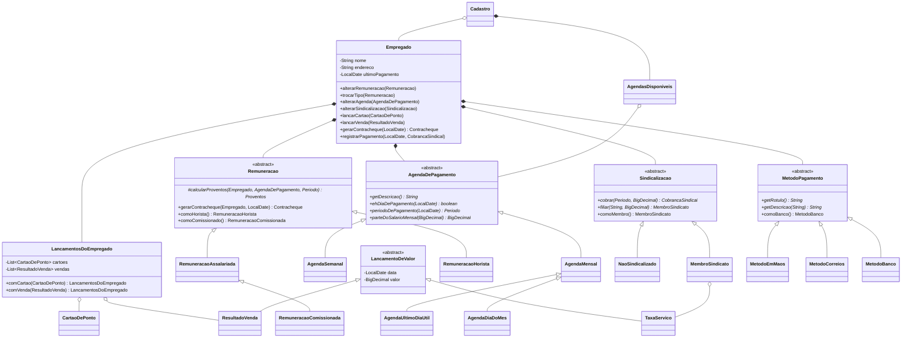
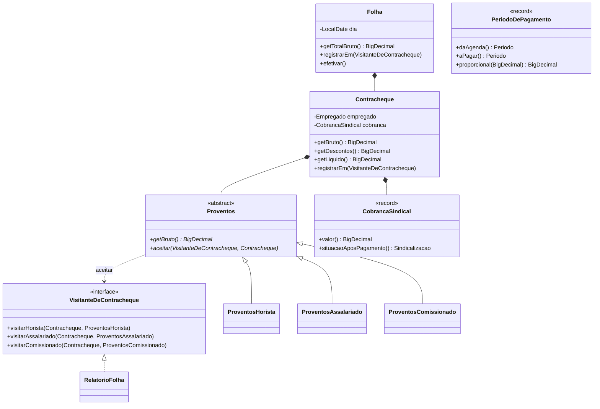

# Camada de Domínio (`models`)

Entidades e objetos de valor do WePayU, divididos por assunto. Nenhuma classe daqui
lê texto dos scripts nem formata a saída: o domínio trabalha com `BigDecimal`,
`LocalDate` e objetos próprios.

### Cálculo da folha (`folha`)

`Remuneracao.gerarContracheque` monta o `Contracheque` sem alterar nada. O `RelatorioFolha`, do pacote `relatorio`, visita cada contracheque para escrever a seção do tipo certo. Só depois de o relatório ser gravado é que `Folha.efetivar` aplica a cobrança do sindicato e o dia do pagamento a cada empregado.

## Subpacotes

| Pacote | Classes | Responsabilidade |
|---|---|---|
| `models` | `Cadastro`, `DadosGravados`, `Periodo`, `Centavos`, `LancamentoDeValor` | o estado do sistema e a sua cópia para gravar; intervalo de datas; cortes em centavos; base de venda e taxa de serviço (data + valor positivo, soma por período) |
| `empregado` | `Empregado`, `LancamentosDoEmpregado`, `CartaoDePonto`, `ResultadoVenda` | o empregado e os seus cartões e vendas |
| `remuneracao` | `Remuneracao` e subclasses, `TipoEmpregado` | quanto cada tipo ganha num período |
| `agenda` | `AgendaDePagamento`, `AgendaSemanal`, `AgendaMensal` (`AgendaUltimoDiaUtil`, `AgendaDiaDoMes`), `AgendasDisponiveis`, `DescricaoDeAgenda` | quando o empregado recebe e que dias cada pagamento cobre (US9), e as agendas que a empresa oferece e cria (US10) |
| `sindicato` | `Sindicalizacao`, `NaoSindicalizado`, `MembroSindicato`, `TaxaServico`, `CobrancaSindical` | filiação, taxas, dívida e desconto no pagamento |
| `pagamento` | `MetodoPagamento` e subclasses | como o salário chega ao empregado |
| `folha` | `Folha`, `Contracheque`, `PeriodoDePagamento`, `Proventos` e subclasses, `VisitanteDeContracheque` | resultado do cálculo da folha, sem alterar nada até ser efetivado |

## Decisões

- **Composição em vez de subclasses de `Empregado`.** Um objeto Java não troca de classe. Por isso o tipo do empregado é a sua `Remuneracao`, e trocar de tipo troca esse objeto. Cartões de ponto, vendas e dívida sindical continuam no empregado, e voltam a ser usados se o tipo antigo voltar.
- **Operações de um só tipo ficam no `Empregado`, protegidas.** `lancarCartao`, `getHorasNormais` e `getHorasExtras` primeiro chamam `remuneracao.comoHorista()`. `lancarVenda` e `getVendasRealizadas` primeiro chamam `comoComissionado()`. Cartões e vendas ficam no `LancamentosDoEmpregado` do empregado, e não na remuneração, porque precisam sobreviver à troca de tipo.
- **Agenda separada do tipo (US9).** Qualquer tipo pode receber em qualquer agenda. A agenda fornece o período e a parte do salário mensal; o tipo calcula o bruto. O comissionado herda do assalariado e reaproveita a parte fixa.
- **Contratação.** É fixada na admissão (`Empregado.admissao`, gravada no XML): 01/01/2005 para quem entra como assalariado ou comissionado (`Remuneracao.contratacaoNaAdmissao`); para quem entra como horista, o primeiro cartão de ponto. A troca de tipo não a muda. As agendas não pagam antes dela, a semanal conta as semanas a partir dela, e a taxa sindical não é cobrada antes dela.
- **Último pagamento.** O empregado guarda o dia do último pagamento efetivado. O período de cada pagamento (`PeriodoDePagamento`) só cobre os dias depois dele, para horas, vendas e taxa sindical, e o mesmo dia nunca é pago duas vezes. A parte fixa do salário fica proporcional aos dias que faltam pagar.
- **Sem `instanceof`.** O que só existe para alguns empregados é acessado por métodos que a classe-mãe implementa lançando o erro de negócio (`comoHorista`, `comoComissionado`, `comoMembro`, `comoBanco`). A subclasse certa responde com ela mesma.
- **Imutabilidade.** `Remuneracao`, `AgendaDePagamento`, `MetodoPagamento`, `Sindicalizacao`, `LancamentosDoEmpregado`, `CartaoDePonto`, `ResultadoVenda` e `TaxaServico` não mudam depois de criados. Só `Empregado` e `Cadastro` são mutáveis, e nenhum dos dois entrega as suas coleções para fora, só vistas somente para leitura. Isso deixa a cópia para o undo simples e segura (`Cadastro.copiar`).
- **Objetos sempre válidos.** Os construtores conferem os próprios dados e lançam a mesma exceção que o script espera.
- **Persistência XML.** Os construtores completos têm `@ConstructorProperties`, que o `XMLDecoder` usa para recriar os objetos sem precisar de setters.
