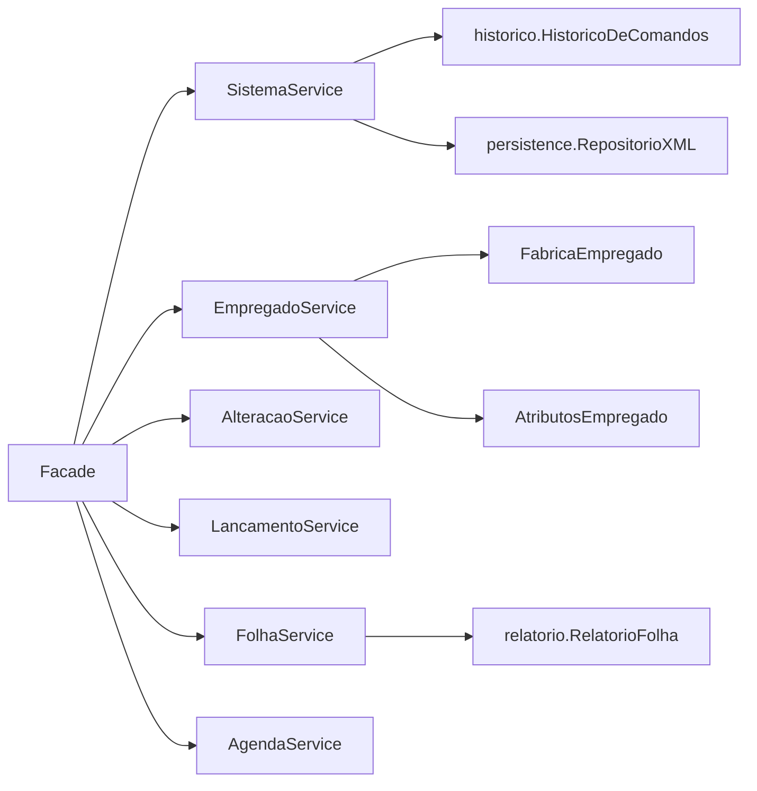

# Camada de Serviços (`services`)

Casos de uso chamados pela [`Facade`](../Facade.java). Os serviços traduzem os
parâmetros de texto dos scripts (via `utils.LeitorDeEntrada`), localizam os
empregados no `Cadastro` e delegam as regras ao domínio.



| Serviço | Responsabilidade |
|---|---|
| `SistemaService` | carrega o estado ao iniciar e o grava ao encerrar. Executa cada comando que altera o estado como uma transação: tira uma foto antes, restaura a foto se o comando falhar e registra o par antes/depois para undo/redo. As consultas passam por `consultar`, que não entra no histórico. Depois de `encerrarSistema`, comandos e consultas são recusados. |
| `EmpregadoService` | contratação (`FabricaEmpregado`), demissão e consultas: atributos (`AtributosEmpregado`), busca por nome e quantidade de empregados |
| `AlteracaoService` | `alteraEmpregado` com 3 a 6 parâmetros. Com 3 parâmetros, cada atributo tem a sua alteração numa tabela, incluindo a escolha da agenda de pagamento (`agendaPagamento`, US9). |
| `LancamentoService` | cartões de ponto, vendas e taxas de serviço, e as consultas sobre eles no intervalo `[dataInicial, dataFinal)`. O empregado e o seu tipo são conferidos antes das datas e dos valores. |
| `FolhaService` | `totalFolha` (só calcula) e `rodaFolha`: calcula, grava o relatório e só então efetiva os pagamentos e guarda o relatório. Rodar de novo a folha de um dia já efetivado regrava o relatório guardado. |
| `AgendaService` | `criarAgendaDePagamentos` (US10): a direção passa a oferecer uma nova agenda de pagamento |
| `FabricaEmpregado` | confere os parâmetros de contratação na ordem em que os scripts esperam os erros e pede a remuneração ao `TipoEmpregado` |
| `AtributosEmpregado` | tabela de leitores de atributos, no formato dos scripts |

## Transações e undo/redo

```text
executar(comando):
    recusa se o sistema foi encerrado
    antes = FotoDoEstado(cadastro)
    comando.executar()
        falhou  -> restaura "antes" e repassa o erro (nada entra no histórico)
        sucesso -> historico.registrar(antes, FotoDoEstado(cadastro))
```

`undo` restaura a foto "antes" do último comando, e `redo` restaura a foto "depois". Um comando novo descarta o que podia ser refeito.
